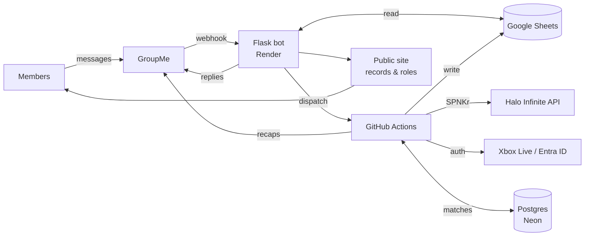
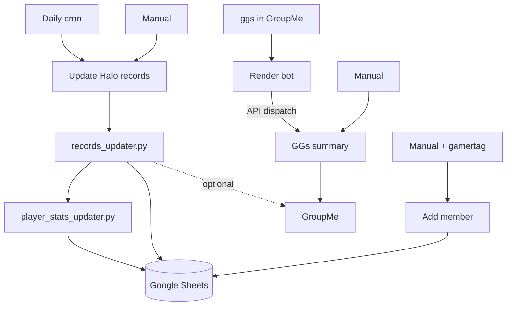

# Trees in Space — TreeBot

**English** · [Español](#español)

TreeBot is the bot and web portal for **Trees in Space**, a Halo Infinite player community on Xbox. It automates what used to be tracked by hand in a spreadsheet: it detects group records from real match data, computes per-player and per-role stats, and publishes them on a public website and in the group's GroupMe chat.

**Live demo:** [records](https://treebot-vunp.onrender.com) · [roles](https://treebot-vunp.onrender.com/roles)

## Tech stack

| Layer | Technology |
|---|---|
| Language | Python 3.11 (web bot on Render and automation scripts) |
| Web / bot | Flask, Gunicorn, Jinja2 templates |
| Data | Google Sheets (`gspread` + a Google Cloud service account) for members, roles and readable records; PostgreSQL on Neon (`psycopg` 3 + connection pool) for match history (v2.0) |
| External APIs | Halo Infinite (unofficial API via [SPNKr](https://pypi.org/project/spnkr/)), Xbox Live (auth through a Microsoft Entra ID app), GroupMe Bots API, GitHub REST API (`workflow_dispatch`) |
| Automation | GitHub Actions (cron, manual runs, API-triggered runs) |
| Hosting | Render (web service, `Procfile` + Gunicorn) |
| Secrets | GitHub Secrets and Render environment variables |

## Architecture

- **Web bot ([`app.py`](app.py), Flask on Render):** receives GroupMe messages through a webhook, answers commands (records, personal stats, menu), and serves the public records and roles pages plus JSON endpoints.
- **Data layer ([`sheets.py`](sheets.py)):** a single Google Sheets access module with a 5‑minute in-memory cache, shared by the bot and the scripts.
- **GitHub Actions workers:** scripts that query the Halo API and write to the sheet or to GroupMe: [`records_updater.py`](records_updater.py), [`player_stats_updater.py`](player_stats_updater.py), [`ggs_summary.py`](ggs_summary.py), [`add_member.py`](add_member.py).
- **Google Sheets:** source of truth for members and roles, and the readable view of records and stats, plus a cache of Xbox IDs (XUIDs).
- **PostgreSQL on Neon (v2.0, [`db.py`](db.py)):** match history of every member (one row per member per match, medals in JSONB) and a daily snapshot of each service record. Schema in [`migrations/`](migrations), applied by [`migrate.py`](migrate.py); filled by [`ingest.py`](ingest.py).

## Data flow

1. **Source: Halo Infinite matches** *(automated)*. A daily workflow authenticates with Xbox Live and uses SPNKr to pull each member's recent matchmaking games.
2. **Processing** *(automated)*. It keeps wins in Big Team Battle, Squad Battle and Heavies with at least 5 group members on the same team (a community rule). Each result is compared with the current record for that map and mode (fastest time, or largest Slayer margin). Lifetime service-record stats are computed per player in the same run.
3. **Storage** *(automated)*. New records are written to Google Sheets and the previous one moves to "Good Times". Stats go to their own sheet, and XUIDs are cached so lookups aren't repeated.
4. **Manual input**. Members are added through a manual workflow (gamertag as input), and each player's roles (Roamer, Anchor, Objective, Driver) are set with checkboxes in the sheet.
5. **Publishing** *(automated, on request)*. The bot reads the sheet (cached) and shows it on the public site (records, roles page with sortable tables), through JSON endpoints (`/api/records`, `/api/roles`), and as replies to GroupMe commands.
6. **Nightly recap** *(on demand)*. When someone types `ggs` in the chat, the bot triggers a workflow that summarizes the last few hours of games (W‑L score, match list and per-game leaders) and posts it to GroupMe in about a minute.
7. **Night awards and player pages** *(automated, v2.0)*. At 01:47 Mexico City the bot starts the night ingestion, which then posts the Night awards (MVP, most improved, best duo) from the database. Each member has a page at `/player/<gamertag>` with their 30-day trend, best duos and strong and weak maps.

## CI/CD with GitHub Actions

| Workflow | Trigger | What it does | Output |
|---|---|---|---|
| [**Update Halo records**](.github/workflows/update-records.yml) | `schedule` (daily cron, 00:17 Mexico City time) and `workflow_dispatch` with a *dry run* option | Step 1: finds new group records. Step 2 (runs even if step 1 fails): computes per-player stats and sorts the roles sheet by last match played | Updated records, player stats and roles sheets; optional GroupMe announcement |
| [**GGs summary**](.github/workflows/ggs.yml) | `workflow_dispatch`: triggered by the bot via the GitHub API, or run manually (look-back hours, *dry run*) | Collects recent games with 2+ members on the same team and builds the recap | GroupMe message. Uses `concurrency` to avoid overlapping runs; the bot enforces a 5‑min cooldown |
| [**Add member**](.github/workflows/add-member.yml) | `workflow_dispatch` (gamertag input) | Validates the gamertag against Xbox, adds the member and saves their match history (default 90 days) | New row in the members sheet; their matches in the database |
| [**Ingest matches**](.github/workflows/ingest.yml) | Started by the bot at 01:47 Mexico City (`source=night`); `schedule` 22:47 and 01:47 as backup; manual | Saves the members' new matches into Postgres (the daily job and every `ggs` do it too). A `night` run then posts the Night awards if `NIGHT_AWARDS=1` | New rows in `matches` / `match_players`; GroupMe awards post |
| [**Database**](.github/workflows/database.yml) | Manual (task + Neon branch `dev` or `production`) | `status`, `migrate`, one-time `import-sheets`, `backfill`, `awards-preview` | Schema and data in Neon; awards printed in the log |
| [**Tests**](.github/workflows/tests.yml) | Every pull request and every push to `master` | Runs the `pytest` suite | Pass/fail check on the PR |

All workflows run on `ubuntu-latest` with Python 3.11, pinned dependencies ([`requirements-updater.txt`](requirements-updater.txt)) and credentials from GitHub Secrets. The web bot is hosted separately on Render.

## Operations (v2.0)

Version 2.0 is in progress; see [CHANGELOG.md](CHANGELOG.md). What keeps the system running:

- **Health:** `GET /health` returns JSON (version, Python, uptime, which features are configured). `GET /health?deep=1` also checks Google Sheets. An external uptime monitor pings `/health` every 5 minutes, which also keeps the free Render instance awake.
- **Daily jobs on time:** the bot starts **Update Halo records** at 00:17 and **Ingest matches** (night, with the awards) at 01:47 Mexico City through the GitHub API ([`scheduler.py`](scheduler.py)). GitHub's cron is only a backup (it often arrives 8–12 hours late).
- **Alerts:** failures go to the private Discord channel `#bot-alerts` ([`alerts.py`](alerts.py)): failed workflows, Halo login errors, Sheets errors and bot crashes.
- **Halo token renewal:** [`halo_auth.py`](halo_auth.py) saves the refresh token Microsoft returns on every login back into the `HALO_REFRESH_TOKEN` secret, so it does not expire after ~90 days. If the login ever fails, run `python get_halo_token.py` and update the secret.
- **Webhook secret:** if `WEBHOOK_TOKEN` is set on Render, the GroupMe callback URL must end in `?token=<value>`.
- **Configuration:** every environment variable is listed in [`.env.example`](.env.example).
- **Tests:** `pip install -r requirements.txt -r requirements-updater.txt pytest` and `python -m pytest`. Database tests need a throwaway local Postgres in `TEST_DATABASE_URL` (CI starts one); without it they are skipped. Never point it at Neon: the tests wipe the schema.

### Database (v2.0)

- **Connection:** `DATABASE_URL` (Neon's *pooled* string, host with `-pooler`). In GitHub Actions the secret is `NEON_PROD_POOLER` and the workflows map it (`env: DATABASE_URL: ${{ secrets.NEON_PROD_POOLER }}`); on Render the variable is `DATABASE_URL`. Without it everything works as in v1. `sslmode=require` is forced and prepared statements are off (PgBouncer).
- **Migrations:** numbered `.sql` files in [`migrations/`](migrations). `python migrate.py` applies the missing ones (each in a transaction, recorded in `schema_migrations`, safe to run again); `--status` lists them. Workflows run it before using the database. Never edit an applied file: add `002_...sql`.
- **Ingestion** ([`ingest.py`](ingest.py)): reads each member's match history, asks the database which (match, member) rows exist, and only requests the missing matches from Halo. Runs in the daily job, at 22:47 and 01:47 Mexico City, and on every `ggs`.
- **Adding members:** run **Add member** as always; it also backfills their history. Anyone who appears in the members sheet for the first time (or comes back) also gets `INGEST_NEW_MEMBER_DAYS` (30) of history on the next ingestion. People removed from the sheet are marked `active = false` and keep their history.
- **First setup in production:** Actions → **Database** → `migrate` (production), then `import-sheets` (copies "XUIDs" and "Player Stats"), then `backfill` with the number of days to load.
- **If the database is down:** records, stats and roles keep working from Sheets; `ggs` falls back to asking Halo directly; snapshots are skipped; an alert goes to `#bot-alerts`. `GET /health?deep=1` shows `database` and the last ingestion.

### Night awards and player pages (v2.0)

- **Turn the awards on:** GitHub → Settings → Secrets and variables → Actions → Variables → `NIGHT_AWARDS` = `1`. Preview any night first with Actions → **Database** → `awards-preview` (production); it only prints.
- **When:** the bot starts **Ingest matches** with `source=night` at `NIGHT_RUN_UTC` (07:47 UTC = 01:47 Mexico City). A night is 16:00 to 10:00 Mexico City; a run before 16:00 means last night. Late runs after noon the next day post nothing, and a night is never posted twice (`night_awards` table).
- **Rules:** group games = 2+ members on the same team (like `ggs`). MVP and most improved need max(3, half the group games) games that night; most improved needs 10+ games in the previous 30 days; best duo needs 5+ games together and at least 50 % wins. Tunable with the `AWARDS_*` variables in [`.env.example`](.env.example).
- **Player page:** `/player/<gamertag>` (spaces and capital letters do not matter) and `/api/player/<gamertag>`. Needs `DATABASE_URL` on Render. Windows and minimums: `PLAYER_*` variables. Links in GroupMe use `PUBLIC_URL` (default `https://treesinspace.net`).

## Challenges and technical decisions

- **Two Python runtimes.** The web service's dependencies ([`requirements.txt`](requirements.txt)) are pinned for an older Python, while SPNKr requires 3.11+. Instead of a risky full migration, the heavy logic moved to GitHub Actions with its own dependency file, and the bot only *triggers* it through the GitHub API. The result is a lightweight web bot plus serverless workers.
- **Halo API rate limits (HTTP 429).** Gamertag lookups were easily throttled. The fix added retry-with-backoff for 429 and 5xx responses, plus a shared XUID cache sheet so each player is looked up only once.
- **Data integrity.** The "record counts only with 5+ members" rule is enforced in code and is configurable. Heavies is classified by map and variant, and map names are normalized. A locale bug was also fixed: the sheet uses decimal commas, so `10,577` was being read as `10577`, and values are now read unformatted.
- **Secrets management.** Credentials are kept out of the repository (explicit [`.gitignore`](.gitignore)), the service-account key was rotated, and everything is injected from GitHub Secrets and Render environment variables.
- **Hands-off operations.** Every workflow has a *dry run* mode and timeouts, and the stats step runs even if the records step fails. Daily upkeep needs no one, and changes can be tested without touching real data.

## What it demonstrates

- **Automation and orchestration:** scheduled and on-demand GitHub Actions pipelines, including runs triggered from an external app via `workflow_dispatch`.
- **API integration:** four external services with different auth schemes (Microsoft/Xbox OAuth, Google service account, bot token, GitHub token).
- **Small-system design:** separation of web service, data layer and workers; caching; rate-limit handling; idempotency and dry runs.
- **Pipeline-as-code and configuration management:** versioned workflows, per-environment variables and centralized secrets.
- **Legacy refactoring:** the bot started in 2022 and was reorganized into modules in 2026 ([`sheets.py`](sheets.py), [`roles.py`](roles.py)), with pinned dependencies and new features.
- **AI-assisted development:** the 2026 modernization was designed and built in pair with Claude (Anthropic) as a coding agent, covering diagnosis, refactoring, new features and production debugging.

---

## Español

TreeBot es el bot y portal web de **Trees in Space**, una comunidad de jugadores de Halo Infinite en Xbox. Automatiza lo que antes se llevaba a mano en una hoja de cálculo: detecta récords del grupo a partir de las partidas reales, calcula estadísticas por jugador y rol, y las publica en una web pública y en el chat de GroupMe del grupo.

**Demo en vivo:** [récords](https://treebot-vunp.onrender.com) · [roles](https://treebot-vunp.onrender.com/roles)

### Stack tecnológico

| Capa | Tecnología |
|---|---|
| Lenguaje | Python 3.11 (bot web en Render y scripts de automatización) |
| Web / bot | Flask, Gunicorn, plantillas Jinja2 |
| Datos | Google Sheets (`gspread` + cuenta de servicio de Google Cloud) para miembros, roles y récords legibles; PostgreSQL en Neon (`psycopg` 3 + pool de conexiones) para el historial de partidas (v2.0) |
| APIs externas | Halo Infinite (API no oficial con [SPNKr](https://pypi.org/project/spnkr/)), Xbox Live (autenticación con una app de Microsoft Entra ID), GroupMe Bots API, GitHub REST API (`workflow_dispatch`) |
| Automatización | GitHub Actions (cron, ejecución manual y disparo por API) |
| Hosting | Render (servicio web, `Procfile` + Gunicorn) |
| Secretos | GitHub Secrets y variables de entorno de Render |

### Arquitectura

- **Bot web ([`app.py`](app.py), Flask en Render):** recibe los mensajes de GroupMe por webhook, responde comandos (récords, estadísticas personales, menú) y sirve las páginas públicas de récords y roles, además de endpoints JSON.
- **Capa de datos ([`sheets.py`](sheets.py)):** acceso único a Google Sheets con caché en memoria de 5 minutos; lo comparten el bot y los scripts.
- **Workers en GitHub Actions:** scripts que consultan la API de Halo y escriben en la hoja o en GroupMe: [`records_updater.py`](records_updater.py), [`player_stats_updater.py`](player_stats_updater.py), [`ggs_summary.py`](ggs_summary.py), [`add_member.py`](add_member.py).
- **Google Sheets:** fuente de verdad de miembros y roles, y vista legible de récords y estadísticas, además de una caché de identificadores de Xbox (XUIDs).
- **PostgreSQL en Neon (v2.0, [`db.py`](db.py)):** historial de partidas de cada miembro (una fila por miembro por partida, medallas en JSONB) y una foto diaria de su service record. Esquema en [`migrations/`](migrations), aplicado con [`migrate.py`](migrate.py); lo llena [`ingest.py`](ingest.py).

Los diagramas de arquitectura y del pipeline están en la sección en inglés.

### Flujo de datos

1. **Fuente: partidas de Halo Infinite** *(automático)*. Un workflow diario se autentica en Xbox Live y, con SPNKr, revisa las últimas partidas de matchmaking de cada miembro.
2. **Procesamiento** *(automático)*. Se filtran las partidas ganadas en Big Team Battle, Squad Battle y Heavies con al menos 5 miembros del grupo en el mismo equipo (regla de la comunidad). Cada resultado se compara con el récord vigente de ese mapa y modo (menor tiempo o mayor margen en Slayer). En la misma ejecución se calcula el historial de por vida de cada jugador.
3. **Almacenamiento** *(automático)*. Los récords nuevos se escriben en Google Sheets y el anterior pasa a "Good Times". Las estadísticas se guardan en una hoja propia y los XUIDs se guardan en caché para no repetir búsquedas.
4. **Datos manuales**. Los miembros se dan de alta con un workflow manual (gamertag de entrada) y los roles de cada jugador (Roamer, Anchor, Objective, Driver) se marcan con casillas en la hoja.
5. **Publicación** *(automático, bajo demanda)*. El bot lee la hoja (con caché) y la muestra en la web pública (récords, página de roles con tablas ordenables), en endpoints JSON (`/api/records`, `/api/roles`) y como respuesta a los comandos de GroupMe.
6. **Resumen de la noche** *(bajo demanda)*. Cuando alguien escribe `ggs` en el chat, el bot dispara un workflow que resume las partidas de las últimas horas (marcador W‑L, lista de partidas y líderes por partida) y lo publica en GroupMe en aproximadamente 1 minuto.
7. **Premios nocturnos y páginas por jugador** *(automático, v2.0)*. A las 01:47 de CDMX el bot arranca la ingesta de la noche, que después publica los Night awards (MVP, most improved, best duo) desde la base de datos. Cada miembro tiene su página en `/player/<gamertag>` con su tendencia de 30 días, mejores duos y mapas fuertes y débiles.

### CI/CD con GitHub Actions

| Workflow | Disparador | Qué hace | Qué produce |
|---|---|---|---|
| [**Update Halo records**](.github/workflows/update-records.yml) | `schedule` (cron diario, 00:17 hora de CDMX) y `workflow_dispatch` con opción *dry run* | Paso 1: busca récords nuevos del grupo. Paso 2 (corre aunque falle el 1): calcula estadísticas por jugador y ordena la hoja de roles por última partida | Hojas de récords, estadísticas y roles actualizadas; aviso opcional en GroupMe |
| [**GGs summary**](.github/workflows/ggs.yml) | `workflow_dispatch`: lo dispara el bot por la API de GitHub o se corre a mano (horas hacia atrás, *dry run*) | Reúne las partidas recientes con 2 o más miembros en el mismo equipo y arma el resumen | Mensaje en GroupMe. Usa `concurrency` para no encimar ejecuciones; el bot aplica un *cooldown* de 5 min |
| [**Add member**](.github/workflows/add-member.yml) | `workflow_dispatch` (gamertag como entrada) | Valida el gamertag contra Xbox, agrega al miembro y guarda su historial de partidas (90 días por defecto) | Nueva fila en la hoja de miembros; sus partidas en la base de datos |
| [**Ingest matches**](.github/workflows/ingest.yml) | Lo arranca el bot a las 01:47 de CDMX (`source=night`); `schedule` 22:47 y 01:47 de respaldo; manual | Guarda en Postgres las partidas nuevas de los miembros (también lo hacen el job diario y cada `ggs`). Una corrida `night` publica después los Night awards si `NIGHT_AWARDS=1` | Filas nuevas en `matches` / `match_players`; premios en GroupMe |
| [**Database**](.github/workflows/database.yml) | Manual (tarea + rama de Neon `dev` o `production`) | `status`, `migrate`, `import-sheets` (una sola vez), `backfill`, `awards-preview` | Esquema y datos en Neon; premios impresos en el log |
| [**Tests**](.github/workflows/tests.yml) | Cada pull request y cada push a `master` | Corre las pruebas de `pytest` | Check de aprobado/fallido en el PR |

Todos corren en `ubuntu-latest` con Python 3.11, dependencias fijadas ([`requirements-updater.txt`](requirements-updater.txt)) y credenciales desde GitHub Secrets. El bot web se aloja por separado en Render.

### Operación (v2.0)

La versión 2.0 está en desarrollo; ver [CHANGELOG.md](CHANGELOG.md). Lo que mantiene el sistema en pie:

- **Salud:** `GET /health` devuelve JSON (versión, Python, tiempo encendido y qué funciones están configuradas). `GET /health?deep=1` también revisa Google Sheets. Un monitor externo hace ping a `/health` cada 5 minutos, lo que además mantiene despierta la instancia gratuita de Render.
- **Jobs diarios a tiempo:** el bot arranca **Update Halo records** a las 00:17 e **Ingest matches** (noche, con los premios) a las 01:47 de CDMX por la API de GitHub ([`scheduler.py`](scheduler.py)). El cron de GitHub queda solo como respaldo (suele llegar 8–12 horas tarde).
- **Alertas:** las fallas llegan al canal privado de Discord `#bot-alerts` ([`alerts.py`](alerts.py)): workflows fallidos, errores de login en Halo, errores de Sheets y caídas del bot.
- **Renovación del token de Halo:** [`halo_auth.py`](halo_auth.py) guarda en el secreto `HALO_REFRESH_TOKEN` el token nuevo que Microsoft devuelve en cada inicio de sesión, así que ya no caduca a los ~90 días. Si algún día falla el login, corre `python get_halo_token.py` y actualiza el secreto.
- **Secreto del webhook:** si `WEBHOOK_TOKEN` está definido en Render, la URL de callback de GroupMe debe terminar en `?token=<valor>`.
- **Configuración:** todas las variables de entorno están en [`.env.example`](.env.example).
- **Pruebas:** `pip install -r requirements.txt -r requirements-updater.txt pytest` y `python -m pytest`. Las pruebas de base de datos necesitan un Postgres local desechable en `TEST_DATABASE_URL` (CI levanta uno); sin él se saltan. Nunca lo apuntes a Neon: las pruebas borran el esquema.

#### Base de datos (v2.0)

- **Conexión:** `DATABASE_URL` (cadena *pooled* de Neon, host con `-pooler`). En GitHub Actions el secreto se llama `NEON_PROD_POOLER` y los workflows lo mapean (`env: DATABASE_URL: ${{ secrets.NEON_PROD_POOLER }}`); en Render la variable se llama `DATABASE_URL`. Sin ella todo funciona como en la v1. Se fuerza `sslmode=require` y se apagan los *prepared statements* (PgBouncer).
- **Migraciones:** archivos `.sql` numerados en [`migrations/`](migrations). `python migrate.py` aplica los que falten (cada uno en una transacción, registrado en `schema_migrations`, se puede correr de nuevo sin problema); `--status` los lista. Los workflows lo corren antes de usar la DB. Nunca edites un archivo ya aplicado: agrega `002_...sql`.
- **Ingesta** ([`ingest.py`](ingest.py)): lee el historial de cada miembro, pregunta a la DB qué filas (partida, miembro) ya existen y solo pide a Halo las partidas que faltan. Corre en el job diario, a las 22:47 y 01:47 de CDMX y en cada `ggs`.
- **Agregar miembros:** corre **Add member** como siempre; también guarda su historial. Quien aparece por primera vez en la hoja de miembros (o regresa) recibe `INGEST_NEW_MEMBER_DAYS` (30) días de historial en la siguiente ingesta. A quien se quita de la hoja se le marca `active = false` y conserva su historial.
- **Primera puesta en producción:** Actions → **Database** → `migrate` (production), luego `import-sheets` (copia "XUIDs" y "Player Stats") y luego `backfill` con los días a cargar.
- **Si la DB no responde:** récords, stats y roles siguen funcionando con Sheets; `ggs` vuelve a pedir todo a Halo; las fotos diarias se saltan; llega una alerta a `#bot-alerts`. `GET /health?deep=1` muestra `database` y la última ingesta.

#### Premios nocturnos y páginas por jugador (v2.0)

- **Activar los premios:** GitHub → Settings → Secrets and variables → Actions → Variables → `NIGHT_AWARDS` = `1`. Antes puedes ver cualquier noche con Actions → **Database** → `awards-preview` (production); solo imprime.
- **Cuándo:** el bot arranca **Ingest matches** con `source=night` a la hora de `NIGHT_RUN_UTC` (07:47 UTC = 01:47 de CDMX). Una noche va de 16:00 a 10:00 de CDMX; antes de las 16:00 cuenta la noche anterior. Si la corrida llega después del mediodía del día siguiente no publica nada, y ninguna noche se publica dos veces (tabla `night_awards`).
- **Reglas:** partidas del grupo = 2 o más miembros en el mismo equipo (como `ggs`). MVP y most improved piden max(3, la mitad de las partidas del grupo) esa noche; most improved pide 10 o más partidas en los 30 días anteriores; best duo pide 5 o más partidas juntos y al menos 50 % de victorias. Se ajustan con las variables `AWARDS_*` de [`.env.example`](.env.example).
- **Página por jugador:** `/player/<gamertag>` (no importan espacios ni mayúsculas) y `/api/player/<gamertag>`. Necesita `DATABASE_URL` en Render. Ventanas y mínimos: variables `PLAYER_*`. Los enlaces en GroupMe usan `PUBLIC_URL` (por defecto `https://treesinspace.net`).

### Retos y decisiones técnicas

- **Dos runtimes de Python.** Las dependencias del servicio web ([`requirements.txt`](requirements.txt)) están fijadas para un Python antiguo, y SPNKr requiere 3.11 o superior. En vez de una migración completa y riesgosa, la lógica pesada se movió a GitHub Actions con su propio archivo de dependencias, y el bot solo la *dispara* por la API de GitHub. Resultado: un bot web ligero y workers sin servidor.
- **Límites de la API de Halo (HTTP 429).** La búsqueda de gamertags se saturaba con facilidad. Se agregaron reintentos con pausa para 429 y 5xx, y una hoja de caché de XUIDs que comparten todos los scripts, de modo que cada jugador se busca una sola vez.
- **Integridad de los datos.** La regla "récord válido solo con 5 o más miembros" está en código y es configurable. Heavies se clasifica por mapa y variante, y los nombres de mapas se normalizan. Además se corrigió un error de configuración regional: la hoja usa coma decimal y `10,577` se leía como `10577`, por lo que ahora se leen valores sin formato.
- **Gestión de secretos.** Las credenciales se mantienen fuera del repositorio ([`.gitignore`](.gitignore) explícito), se rotó la llave de la cuenta de servicio y todo se inyecta desde GitHub Secrets y variables de entorno de Render.
- **Operación sin intervención.** Cada workflow tiene modo *dry run* y *timeouts*, y el paso de estadísticas corre aunque falle el de récords. El mantenimiento diario no requiere a nadie y los cambios se pueden probar sin tocar datos reales.

### Lo que demuestra

- **Automatización y orquestación:** pipelines programados y bajo demanda en GitHub Actions, incluido el disparo desde una app externa vía `workflow_dispatch`.
- **Integración de APIs:** cuatro servicios externos con distintos esquemas de autenticación (OAuth de Microsoft/Xbox, cuenta de servicio de Google, token de bot y token de GitHub).
- **Diseño de sistemas pequeños:** separación entre servicio web, capa de datos y workers; caché; manejo de *rate limits*; idempotencia y *dry runs*.
- **Pipeline-as-code y gestión de configuración:** workflows versionados, variables por entorno y secretos centralizados.
- **Refactorización de código heredado:** el bot nació en 2022 y en 2026 se reorganizó en módulos ([`sheets.py`](sheets.py), [`roles.py`](roles.py)), con dependencias fijadas y nuevas funciones.
- **Desarrollo asistido por IA:** la modernización de 2026 se diseñó e implementó en pareja con Claude (Anthropic) como agente de programación: diagnóstico, refactor, nuevas funciones y depuración en producción.
