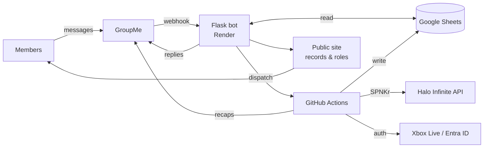
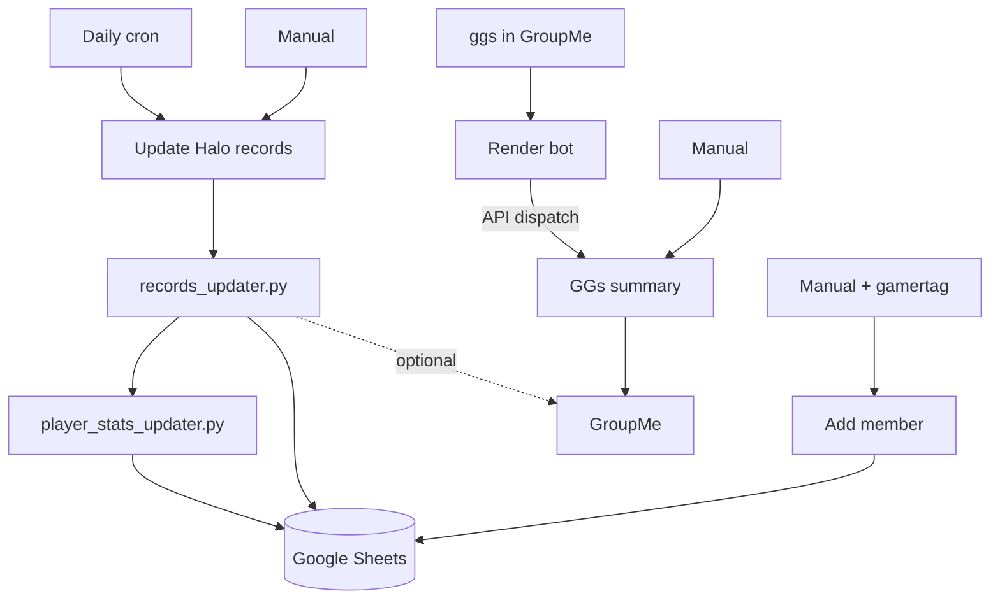

# Trees in Space — TreeBot

**English** · [Español](#español)

TreeBot is the bot and web portal for **Trees in Space**, a Halo Infinite player community on Xbox. It automates what used to be tracked by hand in a spreadsheet: it detects group records from real match data, computes per-player and per-role stats, and publishes them on a public website and in the group's GroupMe chat.

**Live demo:** [records](https://treebot-vunp.onrender.com) · [roles](https://treebot-vunp.onrender.com/roles)

## Tech stack

| Layer | Technology |
|---|---|
| Language | Python (web bot on Render; automation scripts on Python 3.11) |
| Web / bot | Flask, Gunicorn, Jinja2 templates |
| Data | Google Sheets (`gspread` + a Google Cloud service account) |
| External APIs | Halo Infinite (unofficial API via [SPNKr](https://pypi.org/project/spnkr/)), Xbox Live (auth through a Microsoft Entra ID app), GroupMe Bots API, GitHub REST API (`workflow_dispatch`) |
| Automation | GitHub Actions (cron, manual runs, API-triggered runs) |
| Hosting | Render (web service, `Procfile` + Gunicorn) |
| Secrets | GitHub Secrets and Render environment variables |

## Architecture

- **Web bot ([`app.py`](app.py), Flask on Render):** receives GroupMe messages through a webhook, answers commands (records, personal stats, menu), and serves the public records and roles pages plus JSON endpoints.
- **Data layer ([`sheets.py`](sheets.py)):** a single Google Sheets access module with a 5‑minute in-memory cache, shared by the bot and the scripts.
- **GitHub Actions workers:** scripts that query the Halo API and write to the sheet or to GroupMe: [`records_updater.py`](records_updater.py), [`player_stats_updater.py`](player_stats_updater.py), [`ggs_summary.py`](ggs_summary.py), [`add_member.py`](add_member.py).
- **Google Sheets:** works as the database: records, members, roles, stats, and a cache of Xbox IDs (XUIDs).

## Data flow

1. **Source: Halo Infinite matches** *(automated)*. A daily workflow authenticates with Xbox Live and uses SPNKr to pull each member's recent matchmaking games.
2. **Processing** *(automated)*. It keeps wins in Big Team Battle, Squad Battle and Heavies with at least 5 group members on the same team (a community rule). Each result is compared with the current record for that map and mode (fastest time, or largest Slayer margin). Lifetime service-record stats are computed per player in the same run.
3. **Storage** *(automated)*. New records are written to Google Sheets and the previous one moves to "Good Times". Stats go to their own sheet, and XUIDs are cached so lookups aren't repeated.
4. **Manual input**. Members are added through a manual workflow (gamertag as input), and each player's roles (Roamer, Anchor, Objective, Driver) are set with checkboxes in the sheet.
5. **Publishing** *(automated, on request)*. The bot reads the sheet (cached) and shows it on the public site (records, roles page with sortable tables), through JSON endpoints (`/api/records`, `/api/roles`), and as replies to GroupMe commands.
6. **Nightly recap** *(on demand)*. When someone types `ggs` in the chat, the bot triggers a workflow that summarizes the last few hours of games (W‑L score, match list and per-game leaders) and posts it to GroupMe in about a minute.

## CI/CD with GitHub Actions

| Workflow | Trigger | What it does | Output |
|---|---|---|---|
| [**Update Halo records**](.github/workflows/update-records.yml) | `schedule` (daily cron, 00:17 Mexico City time) and `workflow_dispatch` with a *dry run* option | Step 1: finds new group records. Step 2 (runs even if step 1 fails): computes per-player stats and sorts the roles sheet by last match played | Updated records, player stats and roles sheets; optional GroupMe announcement |
| [**GGs summary**](.github/workflows/ggs.yml) | `workflow_dispatch`: triggered by the bot via the GitHub API, or run manually (look-back hours, *dry run*) | Collects recent games with 2+ members on the same team and builds the recap | GroupMe message. Uses `concurrency` to avoid overlapping runs; the bot enforces a 5‑min cooldown |
| [**Add member**](.github/workflows/add-member.yml) | `workflow_dispatch` (gamertag input) | Validates the gamertag against Xbox and adds the member | New row in the members sheet |

All workflows run on `ubuntu-latest` with Python 3.11, pinned dependencies ([`requirements-updater.txt`](requirements-updater.txt)) and credentials from GitHub Secrets. The web bot is hosted separately on Render.

## Challenges and technical decisions

- **Two Python runtimes.** The web service's dependencies ([`requirements.txt`](requirements.txt)) are pinned for an older Python, while SPNKr requires 3.11+. Instead of a risky full migration, the heavy logic moved to GitHub Actions with its own dependency file, and the bot only *triggers* it through the GitHub API. The result is a lightweight web bot plus serverless workers.
- **Halo API rate limits (HTTP 429).** Gamertag lookups were easily throttled. The fix added retry-with-backoff for 429 and 5xx responses, plus a shared XUID cache sheet so each player is looked up only once.
- **Data integrity.** The "record counts only with 5+ members" rule is enforced in code and is configurable. Heavies is classified by map and variant, and map names are normalized. A locale bug was also fixed: the sheet uses decimal commas, so `10,577` was being read as `10577`, and values are now read unformatted.
- **Secrets management.** Credentials are kept out of the repository (explicit [`.gitignore`](.gitignore)), the service-account key was rotated, and everything is injected from GitHub Secrets and Render environment variables.
- **Hands-off operations.** Every workflow has a *dry run* mode and timeouts, and the stats step runs even if the records step fails. Daily upkeep needs no one, and changes can be tested without touching real data.

## What it demonstrates

- **Automation and orchestration:** scheduled and on-demand GitHub Actions pipelines, including runs triggered from an external app via `workflow_dispatch`.
- **API integration:** four external services with different auth schemes (Microsoft/Xbox OAuth, Google service account, bot token, GitHub token).
- **Small-system design:** separation of web service, data layer and workers; caching; rate-limit handling; idempotency and dry runs.
- **Pipeline-as-code and configuration management:** versioned workflows, per-environment variables and centralized secrets.
- **Legacy refactoring:** the bot started in 2022 and was reorganized into modules in 2026 ([`sheets.py`](sheets.py), [`roles.py`](roles.py)), with pinned dependencies and new features.
- **AI-assisted development:** the 2026 modernization was designed and built in pair with Claude (Anthropic) as a coding agent, covering diagnosis, refactoring, new features and production debugging.

---

## Español

TreeBot es el bot y portal web de **Trees in Space**, una comunidad de jugadores de Halo Infinite en Xbox. Automatiza lo que antes se llevaba a mano en una hoja de cálculo: detecta récords del grupo a partir de las partidas reales, calcula estadísticas por jugador y rol, y las publica en una web pública y en el chat de GroupMe del grupo.

**Demo en vivo:** [récords](https://treebot-vunp.onrender.com) · [roles](https://treebot-vunp.onrender.com/roles)

### Stack tecnológico

| Capa | Tecnología |
|---|---|
| Lenguaje | Python (bot web en Render; scripts de automatización en Python 3.11) |
| Web / bot | Flask, Gunicorn, plantillas Jinja2 |
| Datos | Google Sheets (`gspread` + cuenta de servicio de Google Cloud) |
| APIs externas | Halo Infinite (API no oficial con [SPNKr](https://pypi.org/project/spnkr/)), Xbox Live (autenticación con una app de Microsoft Entra ID), GroupMe Bots API, GitHub REST API (`workflow_dispatch`) |
| Automatización | GitHub Actions (cron, ejecución manual y disparo por API) |
| Hosting | Render (servicio web, `Procfile` + Gunicorn) |
| Secretos | GitHub Secrets y variables de entorno de Render |

### Arquitectura

- **Bot web ([`app.py`](app.py), Flask en Render):** recibe los mensajes de GroupMe por webhook, responde comandos (récords, estadísticas personales, menú) y sirve las páginas públicas de récords y roles, además de endpoints JSON.
- **Capa de datos ([`sheets.py`](sheets.py)):** acceso único a Google Sheets con caché en memoria de 5 minutos; lo comparten el bot y los scripts.
- **Workers en GitHub Actions:** scripts que consultan la API de Halo y escriben en la hoja o en GroupMe: [`records_updater.py`](records_updater.py), [`player_stats_updater.py`](player_stats_updater.py), [`ggs_summary.py`](ggs_summary.py), [`add_member.py`](add_member.py).
- **Google Sheets:** funciona como base de datos: récords, miembros, roles, estadísticas y una caché de identificadores de Xbox (XUIDs).

Los diagramas de arquitectura y del pipeline están en la sección en inglés.

### Flujo de datos

1. **Fuente: partidas de Halo Infinite** *(automático)*. Un workflow diario se autentica en Xbox Live y, con SPNKr, revisa las últimas partidas de matchmaking de cada miembro.
2. **Procesamiento** *(automático)*. Se filtran las partidas ganadas en Big Team Battle, Squad Battle y Heavies con al menos 5 miembros del grupo en el mismo equipo (regla de la comunidad). Cada resultado se compara con el récord vigente de ese mapa y modo (menor tiempo o mayor margen en Slayer). En la misma ejecución se calcula el historial de por vida de cada jugador.
3. **Almacenamiento** *(automático)*. Los récords nuevos se escriben en Google Sheets y el anterior pasa a "Good Times". Las estadísticas se guardan en una hoja propia y los XUIDs se guardan en caché para no repetir búsquedas.
4. **Datos manuales**. Los miembros se dan de alta con un workflow manual (gamertag de entrada) y los roles de cada jugador (Roamer, Anchor, Objective, Driver) se marcan con casillas en la hoja.
5. **Publicación** *(automático, bajo demanda)*. El bot lee la hoja (con caché) y la muestra en la web pública (récords, página de roles con tablas ordenables), en endpoints JSON (`/api/records`, `/api/roles`) y como respuesta a los comandos de GroupMe.
6. **Resumen de la noche** *(bajo demanda)*. Cuando alguien escribe `ggs` en el chat, el bot dispara un workflow que resume las partidas de las últimas horas (marcador W‑L, lista de partidas y líderes por partida) y lo publica en GroupMe en aproximadamente 1 minuto.

### CI/CD con GitHub Actions

| Workflow | Disparador | Qué hace | Qué produce |
|---|---|---|---|
| [**Update Halo records**](.github/workflows/update-records.yml) | `schedule` (cron diario, 00:17 hora de CDMX) y `workflow_dispatch` con opción *dry run* | Paso 1: busca récords nuevos del grupo. Paso 2 (corre aunque falle el 1): calcula estadísticas por jugador y ordena la hoja de roles por última partida | Hojas de récords, estadísticas y roles actualizadas; aviso opcional en GroupMe |
| [**GGs summary**](.github/workflows/ggs.yml) | `workflow_dispatch`: lo dispara el bot por la API de GitHub o se corre a mano (horas hacia atrás, *dry run*) | Reúne las partidas recientes con 2 o más miembros en el mismo equipo y arma el resumen | Mensaje en GroupMe. Usa `concurrency` para no encimar ejecuciones; el bot aplica un *cooldown* de 5 min |
| [**Add member**](.github/workflows/add-member.yml) | `workflow_dispatch` (gamertag como entrada) | Valida el gamertag contra Xbox y agrega al miembro | Nueva fila en la hoja de miembros |

Todos corren en `ubuntu-latest` con Python 3.11, dependencias fijadas ([`requirements-updater.txt`](requirements-updater.txt)) y credenciales desde GitHub Secrets. El bot web se aloja por separado en Render.

### Retos y decisiones técnicas

- **Dos runtimes de Python.** Las dependencias del servicio web ([`requirements.txt`](requirements.txt)) están fijadas para un Python antiguo, y SPNKr requiere 3.11 o superior. En vez de una migración completa y riesgosa, la lógica pesada se movió a GitHub Actions con su propio archivo de dependencias, y el bot solo la *dispara* por la API de GitHub. Resultado: un bot web ligero y workers sin servidor.
- **Límites de la API de Halo (HTTP 429).** La búsqueda de gamertags se saturaba con facilidad. Se agregaron reintentos con pausa para 429 y 5xx, y una hoja de caché de XUIDs que comparten todos los scripts, de modo que cada jugador se busca una sola vez.
- **Integridad de los datos.** La regla "récord válido solo con 5 o más miembros" está en código y es configurable. Heavies se clasifica por mapa y variante, y los nombres de mapas se normalizan. Además se corrigió un error de configuración regional: la hoja usa coma decimal y `10,577` se leía como `10577`, por lo que ahora se leen valores sin formato.
- **Gestión de secretos.** Las credenciales se mantienen fuera del repositorio ([`.gitignore`](.gitignore) explícito), se rotó la llave de la cuenta de servicio y todo se inyecta desde GitHub Secrets y variables de entorno de Render.
- **Operación sin intervención.** Cada workflow tiene modo *dry run* y *timeouts*, y el paso de estadísticas corre aunque falle el de récords. El mantenimiento diario no requiere a nadie y los cambios se pueden probar sin tocar datos reales.

### Lo que demuestra

- **Automatización y orquestación:** pipelines programados y bajo demanda en GitHub Actions, incluido el disparo desde una app externa vía `workflow_dispatch`.
- **Integración de APIs:** cuatro servicios externos con distintos esquemas de autenticación (OAuth de Microsoft/Xbox, cuenta de servicio de Google, token de bot y token de GitHub).
- **Diseño de sistemas pequeños:** separación entre servicio web, capa de datos y workers; caché; manejo de *rate limits*; idempotencia y *dry runs*.
- **Pipeline-as-code y gestión de configuración:** workflows versionados, variables por entorno y secretos centralizados.
- **Refactorización de código heredado:** el bot nació en 2022 y en 2026 se reorganizó en módulos ([`sheets.py`](sheets.py), [`roles.py`](roles.py)), con dependencias fijadas y nuevas funciones.
- **Desarrollo asistido por IA:** la modernización de 2026 se diseñó e implementó en pareja con Claude (Anthropic) como agente de programación: diagnóstico, refactor, nuevas funciones y depuración en producción.
